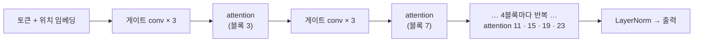

# BitGC LM

**가중치가 {−1, 0, +1} 뿐인 1B 한국어 언어 모델 — 학습부터 대화까지.**

BitGC 는 BitNet b1.58 식 **삼진(1.58-bit) 가중치**와, 대부분의 층에서 attention 대신 쓰는 **게이트 합성곱(gated conv)** 을
섞은 언어 모델입니다. 같은 크기의 일반 Transformer 와 비슷한 품질을 내면서, 가중치 행렬곱에 곱셈이 필요 없고
메모리를 적게 읽어서 **GPU 없이 CPU 에서도 1B 모델로 대화할 수 있게** 만드는 것이 목표입니다.

이 저장소에는 그런 모델을 **처음부터 만들고 쓰는 데 필요한 코드 전부**가 있습니다 — 토크나이저 학습, 사전학습, 대화·지시
미세조정(SFT), 추론. 학습된 1B 모델은 Hugging Face 에 공개돼 있어 바로 써 볼 수 있습니다.

```bash
git clone https://github.com/Trace-0/bitgc-lm && cd bitgc-lm && pip install -r requirements.txt
python chat.py --ckpt hf:trace-000/bitgc-lm-1b          # GPU 가 없어도 된다 (CPU fp32, 메모리 ~5GB)
```

```
사용자> 내 이름은 민수야.
모델> 네, 기억할게요.
사용자> 내 이름이 뭐라고 했지?
모델> 민수라고 했어요.
```

*English: BitGC is a 1.09B-parameter Korean LM with ternary (BitNet b1.58) weights in every block and a hybrid of
gated depthwise convolutions (18 layers) and self-attention (6 layers). This repo contains the full pipeline —
tokenizer, pretraining, SFT, inference — plus an automatic "recall-layer" probe that runs during pretraining and a
response-start gate that the probe's result drives. Weights: [trace-000/bitgc-lm-1b](https://huggingface.co/trace-000/bitgc-lm-1b).*

---

## 한눈에 보기

1B 모델끼리, 같은 데이터(2.375B 토큰)·같은 토크나이저·같은 평가로 비교한 값입니다 (원 연구 논문의 측정).

| | **BitGC 1B** | BitNet 1B (전부 attention) | 일반 Transformer 1B (실수, bf16) |
|---|---|---|---|
| 가중치 | 삼진 {−γ, 0, +γ} | 삼진 | 16비트 실수 |
| 사전학습 val ppl ↓ | **9.02** | 9.79 | 8.74 |
| attention 층 / 전체 | **6 / 24** | 21 / 21 | 21 / 21 |
| 생성 속도 (CPU, 문맥 64)¹ | **5.1 ms/토큰** | 7.2 ms/토큰 | 38.7 ms/토큰 |
| 생성 에너지¹ | **0.18 J/토큰** | 0.25 J/토큰 | 1.15 J/토큰 |

- **품질**: 일반 실수 Transformer 와의 ppl 차이는 +3% 입니다. 같은 삼진 가중치의 BitNet 보다는 8% 낫습니다.
- **효율**¹: 같은 크기의 bf16 Transformer 보다 생성이 **7.5배 빠르고** 에너지는 **6.5배 적게** 씁니다.
  int8 로 양자화한 Transformer 와 비교해도 4배 빠릅니다.
- **대화·지시**: 회상 층 게이트(아래)로 지시 따르기 126문항 정답이 **55.7 → 75.0** 으로 올랐습니다 (게이트가 없는 이전 설계와 비교, 시드 3개 평균).

¹ 속도·에너지는 이 저장소에 들어 있는 **C 정수 엔진**(`bitgc/engine`, 아래 「정수 엔진」)으로 잰 원 연구의 값입니다.
배치 1이고, 모든 모델을 같은 엔진으로 실행했습니다. BitGC 줄은 최종 모델의 바로 앞 설계(E1c)에서 잰 값입니다.
최종 모델은 크기와 커널이 같아서, 같은 세션에서 잰 차이가 측정 폭 안이었습니다. 절대값은 CPU와 측정 세션에 따라 달라집니다.
이 저장소의 엔진은 같은 세션에서 원 연구 엔진과 같은 속도를 냈습니다(6.7 대 6.6 ms/토큰).

## 왜 이 구조인가



블록 하나는 `x + s₁·혼합층(LN(x))` → `x + s₂·FFN(LN(x))` 입니다. 각 부분이 맡는 일은 다음과 같습니다.

| 구성 | 하는 일 | 얻는 것 |
|---|---|---|
| **삼진 BitLinear** (모든 선형층) | 입력 정규화 → 토큰별 8bit 활성 → 가중치를 {−γ, 0, +γ} 로 반올림 (학습은 straight-through) | 행렬곱이 덧셈·뺄셈만으로 끝난다. 가중치 메모리가 16비트의 약 1/10 |
| **게이트 conv** (18층) | `W_o( conv(v) ⊙ σ(conv_gate(v)) )`, 채널별 인과 conv · 커널 9 | 위치를 섞는 비용이 문맥 길이와 무관하다. 이 층들에는 KV 캐시가 없다 |
| **attention** (6층) | 일반 causal self-attention | 먼 거리의 정보를 찾아오는 일(회상)을 맡는다. KV 캐시는 같은 층 수의 전부-attention 모델의 1/4 |
| **ReLU² FFN** | `fc2( relu(fc1(x))² )`, fc2 입력은 RMSNorm (0 을 보존) | fc2 입력의 대부분이 정확히 0 → 그 열은 읽지 않아도 된다. 토큰당 메모리 읽기 **−35%** |
| **잔차 스칼라** s₁, s₂ | 블록 출력마다 학습되는 스칼라 (초깃값 1/√48) | 앞쪽 attention 층(3·7)을 닫아 회상을 한 층(11)에 모은다. conv 팽창을 없앤 것과 함께, 이전 설계보다 ppl 2.4% ↓ (9.25 → 9.02) |

이 배합은 논문에서 30M·150M·1B 로 하나씩 바꿔 보며 고른 것입니다. 1B 에서 혼합층의 3/4 를 conv 로 바꾸면 실수 모델은
ppl 이 오히려 좋아졌고(8.74 → 8.31), 삼진 모델의 최종 설계는 전부 attention 인 BitNet 보다 좋아졌습니다(9.79 → 9.02).

## 회상 층 게이트 — 이 저장소만의 장치

conv 가 대부분인 망에서는 **attention 층 하나가 '문맥에서 값을 찾아 옮기기'(회상)를 도맡게** 됩니다.
1B 모델에서 그 층을 끄면 연상 회상 정답이 33% 에서 0.5% 로 떨어집니다. 이 성질 덕분에 글 읽기와 비밀번호 회상이 강해지는데,
대화 SFT 뒤에는 같은 층이 답의 첫 토큰을 질문 첫머리에서 베껴 **질문을 그대로 되풀이**하기도 했습니다.

처방은 **응답이 시작되는 위치(`<|bot|>`)에서만 그 층의 출력을 막고 SFT 하는 것**입니다. 그러면 다른 층들이 답의
첫 토큰을 맡도록 배웁니다. 원 연구에서 확인한 사실은 다음과 같습니다.

- 추론할 때만 막으면 되풀이 대신 빈 답이 나온다 → **SFT 할 때부터 막아야 한다.**
- 막고 학습한 모델도 추론할 때 게이트를 떼면 다시 무너진다 (지시 126문항 64 → 22) → 게이트는 모델 구조의 일부다.
- 사전학습 때부터 막으면 다른 층이 같은 베끼기를 다시 만든다 → 사전학습에는 걸지 않는다.

어려운 점은 **어느 층이 회상 층이 될지 미리 알 수 없다는 것**입니다. 학습 초반에 attention 층들이 경쟁하듯
회상을 배우고, 먼저 앞선 층이 끝까지 맡습니다. 같은 30M 설정에서도 시드 8개 중 6개는 블록 3, 2개는 블록 7 이었습니다.
층 수나 데이터가 바뀌면 위치도 바뀝니다. 그래서 이 저장소는 그 과정을 자동으로 처리합니다.

```
train.py  ── 500 step 마다: attention 층을 하나씩 질의 위치에서 끄고 연상 회상 정답 log p 가 얼마나 떨어지는지 잰다
             → 가장 크게 떨어뜨리는 층 = 회상 층. 3번 연속 같으면 '확정'하고 체크포인트에 recall 기록으로 남긴다
sft.py    ── 체크포인트의 기록을 읽어 그 층을 모든 <|bot|> 위치에서 막은 채 학습한다. 기록은 다음 단계로 넘긴다
chat.py   ── 불러올 때 기록대로 게이트를 건다 (--compare-gate 로 켬/끔 비교)
```

```
  step 1000 [회상 측정 assoc] … | 층별 끄기 Δlogp/정답 b3:+0.93/0% b7:+0.83/0% | 회상 층 b3 나뉨 (후보 1/3)
  step 1500 [회상 측정 assoc] … | 층별 끄기 Δlogp/정답 b3:+1.76/0% b7:+0.77/3% | 회상 층 b3 (확정(step 1000~, 3회))
```

자동 측정이 원 연구의 판정을 맞히는지 확인한 결과입니다.

| 확인 | 결과 |
|---|---|
| 30M 시드 8개 (블록 3 이 6개, 블록 7 이 2개) | **8/8** 일치. 학습 초반 스냅샷에서도 step 1000 부터 8/8 이고, 그 뒤로 바뀌지 않았다 |
| 150M 3개 · 1B 2개 (최종 모델 블록 11, 이전 설계 블록 7) | 전부 일치 |
| 이 저장소의 `train.py` 로 30M 을 다시 학습 (시드 1 · 4) | 학습 중에 블록 3 · 블록 7 을 각각 확정하고 체크포인트에 기록했다 (원 판정과 같다) |
| 새 코드의 게이트 vs 원 연구 코드의 게이트 (1B 최종 모델) | 로짓 차이 **0** |

## 빠르게 써 보기

| 모델 | 설명 |
|---|---|
| [**trace-000/bitgc-lm-1b**](https://huggingface.co/trace-000/bitgc-lm-1b) | 대화·지시 모델. 회상 층(블록 11) 게이트 포함 |
| [trace-000/bitgc-lm-1b-base](https://huggingface.co/trace-000/bitgc-lm-1b-base) | 사전학습 모델. 직접 SFT 할 때 쓴다 |

```bash
python chat.py --ckpt hf:trace-000/bitgc-lm-1b                                   # 여러 턴 대화 (/reset · /gate off · /quit)
python chat.py --ckpt hf:trace-000/bitgc-lm-1b --prompt "세종대왕은 어떤 업적을 남겼어?"
python chat.py --ckpt hf:trace-000/bitgc-lm-1b --prompt "…" --compare-gate       # 게이트 켬/끔 나란히
python chat.py --ckpt hf:trace-000/bitgc-lm-1b-base --text "옛날 옛적에" --temperature 0.7 --top-k 40
```

KV 캐시와 conv 상태를 이어 쓰는 증분 생성이라 CPU 에서도 돌아갑니다 (`--bf16` 은 GPU 용). 토크나이저는 모델 저장소에
함께 들어 있습니다. 디코딩 기본값은 논문의 최종 평가 설정을 따릅니다: greedy · 반복 벌점 1.2 · 같은 6-gram 금지.

```
$ python chat.py --engine bitgc_1b.npz --tokenizer tokenizer.model --prompt "김치찌개 맛있게 끓이는 방법 알려줘" --compare-gate
[게이트 켬] 김치찌개에 대해 궁금하시군요.
[게이트 끔] 김치찌개 맛있게 끓이는 방법          ← 회상 층이 질문 첫머리를 그대로 베낀다
```

## 정수 엔진 — CPU 에서 빠르게

`bitgc/engine` 은 삼진 가중치 × 8bit 활성 행렬곱을 **곱셈 없이** 하는 C 엔진입니다(OpenMP, AVX2 / AVX-512 VNNI).
한 토큰을 C 함수 하나로 처리하고, KV 캐시와 conv 링 버퍼를 안에서 관리합니다. 회상 층 게이트도 엔진 안에서 걸립니다.

```bash
python -m bitgc.engine.build                                                     # 한 번 (Linux · WSL · macOS, gcc/clang)
python scripts/export_engine.py --ckpt hf:trace-000/bitgc-lm-1b --out bitgc_1b.npz --tokenizer tokenizer.model --parity
python chat.py --engine bitgc_1b.npz --tokenizer tokenizer.model                 # 대화
python scripts/bench_engine.py --engine bitgc_1b.npz                             # 속도
```

| 1B 최종 모델 (16스레드 CPU, 같은 세션) | 결과 |
|---|---|
| 엔진 자산 | 411MB (삼진 가중치 264MB) — fp32 가중치 4.4GB 의 1/10 |
| 생성 속도 | 6.7 ms/토큰 (문맥 64) · 8.0 ms/토큰 (문맥 448). 원 연구 엔진도 같은 세션에서 6.6 · 7.9 |
| torch 와의 정합 | top-1 98~99%, 응답 표지 위치 100%, NLL 차이 0.013 이하 (8bit 반올림 경계 때문에 완전히 같지는 않다) |
| 지시 따르기 126문항 | 73점 · 원 연구 엔진 출력과 **126/126 같은 답** (126문항에 23초) |

fc2 는 열 단위로 저장해서, ReLU² 출력이 0 인 입력의 열은 읽지 않습니다. 엔진은 d_model · d_ff 가 256 의 배수여야 합니다
(`configs/` 의 세 설정은 모두 맞습니다). Windows 에서는 WSL 에서 빌드·실행하세요.

## 직접 만들기

크기별 설정은 `configs/` 에 있습니다. 층 수와 attention 위치는 인자로 바꿀 수 있습니다 (`--n-layers 12 --attn-layers 3,7,11`).

| 설정 | 형상 | 파라미터 | 참고 |
|---|---|---|---|
| `bitgc_30m.json` | d512 · 8층 · attention 3,7 | 31M | RTX 3090 에서 1억 토큰 ~20분. 구조를 실험하거나 회상 층을 미리 볼 때 |
| `bitgc_150m.json` | d1024 · 12층 · attention 3,7,11 | 150M | |
| `bitgc_1b.json` | d2048 · 24층 · attention 3,7,11,15,19,23 | 1.09B | 공개 모델. A100 40GB 로 2.4B 토큰에 ~33시간 |

**1) 토크나이저와 데이터**

```bash
python scripts/train_tokenizer.py --input corpus.txt chat.jsonl --out tokenizer/my_spm --vocab 16384
python scripts/prepare_pretrain.py --input wiki.jsonl docs.txt --tokenizer tokenizer/my_spm.model --out data/corpus.bin --shuffle-docs
python scripts/prepare_sft.py --input chat.jsonl --tokenizer tokenizer/my_spm.model --out data/sft_chat.pt
```

사전학습 입력은 `.jsonl`(`{"text": …}`) 이나 빈 줄로 문서를 나눈 `.txt` 입니다. SFT 입력은 `{"turns": [["user", "…"], ["bot", "…"], …]}` 입니다.
공개 모델과 같은 토크나이저를 쓰려면 `huggingface-cli download trace-000/bitgc-lm-1b tokenizer.model --local-dir tokenizer` 로 받습니다.

**2) 사전학습** — 회상 층을 자동으로 재고 기록합니다

```bash
python train.py --data data/corpus.bin --tokenizer tokenizer/my_spm.model --config configs/bitgc_1b.json \
    --out-dir runs/1b --batch-size 16 --lr 1.5e-4 --warmup 3000 --amp bf16 --compile --grad-ckpt \
    --eval-every 8000 --ckpt-every 4000 --probe-every 500 --max-hours 22.5
```

`--grad-ckpt` 를 쓰면 1B 가 24GB GPU 에 들어갑니다. 중간에 끊겨도 같은 명령을 다시 실행하면 `resume.pt` 에서 이어집니다
(`--max-hours` · `--stop-file` 로 스스로 저장하고 멈출 수 있습니다). 측정 기록은 `recall.jsonl` 에 남습니다.
작은 모델로 회상 층만 먼저 보고 싶으면 `--stop-at-step 3000` 을 씁니다 (lr 일정은 전체 길이 그대로).

**3) SFT** — 기록된 회상 층을 응답 첫 토큰에서 막고 학습합니다

```bash
python sft.py --ckpt runs/1b/best.pt --data data/sft_chat.pt --tokenizer tokenizer/my_spm.model --out runs/1b/chat.pt \
    --epochs 1 --epoch-frac 0.5 --lr 3e-5 --replay data/corpus.bin --replay-per-batch 4 --compile
```

공개 모델은 대화 → 글 읽기 → 지시 순서로 세 번 이어서 학습했습니다 (각 단계의 산출이 다음 단계의 `--ckpt`). `--replay` 는
배치 절반을 사전학습 코퍼스로 채워 미세조정 중의 망각을 줄입니다. 평가 로그에는 '첫 답 베끼기' 비율이 게이트 켬/끔으로 같이 나옵니다.

**4) 추론과 배포**

```bash
python chat.py --ckpt runs/1b/instr.pt --tokenizer tokenizer/my_spm.model
python scripts/export_pretrained.py --ckpt runs/1b/instr.pt --tokenizer tokenizer/my_spm.model --out export/my-model
python scripts/probe_recall.py --ckpt export/my-model --K 4,8,16          # 아무 체크포인트나 회상 층을 다시 잰다
```

`export_pretrained.py` 는 체크포인트를 `model.safetensors` + `config.json` + `tokenizer.model` 폴더로 바꾸고, 바꾼 뒤 원본과 로짓이 같은지 확인합니다.
이 폴더를 Hugging Face 에 올리면 `--ckpt hf:사용자/저장소` 로 바로 쓸 수 있습니다.

## 저장소 구성

```
bitgc/model.py         모델 (BitLinear · 게이트 conv · attention · ReLU² · 잔차 스칼라 · 회상 층 게이트 · 증분 캐시)
bitgc/recall_probe.py  회상 층 측정 (연상 회상 · 유도 복사) 과 판정 추적기
bitgc/generate.py      증분 생성 · 대화 형식 · 디코딩 규칙
bitgc/checkpoint.py    체크포인트 형식 (.pt / safetensors 폴더 / hf:)
bitgc/engine/          C 정수 엔진 (csrc/ 커널 · runtime.py · build.py)
train.py · sft.py · chat.py
scripts/               토크나이저 · 데이터 준비 · 회상 측정 · 내보내기(safetensors · 엔진) · 엔진 속도 · 원 연구 체크포인트 변환
tests/test_model.py    증분 생성 = 전체 계산 · 게이트는 응답 위치만 · 저장·복원 · 엔진 = torch (CPU 몇 초)
```

## 한계

- 1B 로는 작은 모델입니다. 사실 지식, 긴 문맥(512 토큰), 열린 대화가 약하고 틀린 내용을 지어낼 수 있습니다. 한국어 전용입니다.
- 평가 수치는 원 연구가 직접 만든 평가입니다 (외부 벤치마크가 아닙니다).
- '회상 층 = 되풀이를 만드는 층' 이라는 대응은 1B 모델 하나에서 확인했습니다. 다른 설정에서는 `sft.py` 로그의 첫 답 베끼기(게이트 켬/끔)로 확인하세요.
- 게이트는 기본으로 층 하나만 막습니다. 회상이 두 층에 나뉜 모델(측정 결과 `split`)에서 한 층만 막아도 되는지는 검증하지 않았습니다.
- PyTorch 추론은 fp32 에서 8bit 활성 반올림 경계 때문에 계산 순서에 따라 로짓이 조금 달라질 수 있습니다 (fp64 에서는 증분 = 전체 1e-13).

## 출처 표기 · 라이선스

공개 가중치와 토크나이저는 **AI 허브 (https://www.aihub.or.kr)** 의 다음 데이터를 활용해 만들었습니다:
009. 전문분야_기술과학_한국어 멀티세션 데이터 · 010. 전문분야_사회과학_한국어 멀티세션 데이터 · 045. 지식검색 대화 ·
048. 일반상식 문장 생성 데이터 · 049. 일반상식 문장 생성 평가 데이터 · 121. 한국어 성능이 개선된 초거대AI 언어모델 개발 및 데이터.
그 밖에 한국어 위키백과 (https://ko.wikipedia.org, CC BY-SA 4.0) 를 썼습니다. 데이터 자체는 포함하지 않습니다.

코드는 MIT 라이선스입니다.
